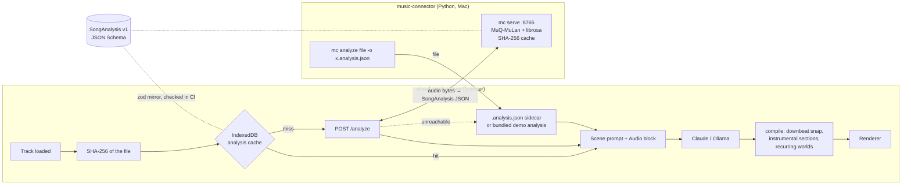
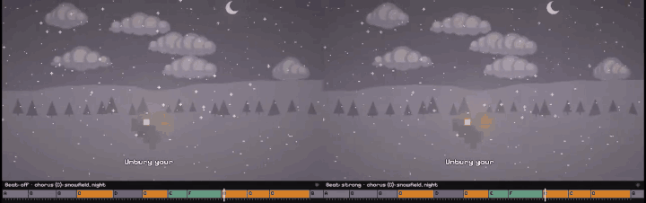

# Visual Music Player

A web music player that pictures what a song *means*. An LLM reads the lyrics once and writes a
scene script; a procedural pixel-art engine draws that script in sync with playback, and the music
drives how alive the scene is. The design and roadmap live in [SPEC.md](SPEC.md).

Static site: Vite + TypeScript, no UI framework, no backend.


*Left: `main` before Phase 1. Right: sprite-sheet people with planted feet, shot framing, and
subjects kept above the captions and player bar. Both sides are `?demo&t=…&freeze` frames at
12 fps.*

## Features

- Local-file playback: drag-drop audio files (and `.lrc` sidecars) or remember a folder.
- Lyrics from a local `.lrc` sidecar or [LRCLIB](https://lrclib.net), with word timing and a
  per-song offset.
- Scene scripts from Claude (subscription or API key) or a local Ollama model, constrained to a
  closed vocabulary so every scene is drawable, and cached per song and model.
- 13 looks (natural, synthwave, lo-fi, noir, storybook, Game Boy, ukiyo-e, …), or a palette taken from
  a reference image.
- People drawn from LPC sprite sheets (walk, idle, sit, reach and dance cycles), recoloured from the
  song's cast, with feet that stay planted while walking.
- A shot per lyric line (wide, medium or close) that sets subject size and where the horizon sits,
  and keeps people above the captions and player bar.
- Optional audio analysis from [music-connector](https://github.com/karanr17/music-connector)
  (tempo, bars, repeating parts, sound descriptors): scene changes land on downbeats, instrumental
  stretches get worlds of their own, and a returning chorus returns to its world. See
  [Audio analysis](#audio-analysis-music-connector).
- Music-driven animation from the analysis's beat grid: footsteps land on beats, the light lifts on
  downbeats, strong beats nudge the camera, standing figures nod along, and particles follow the
  high band. **Beat** in the player bar sets it to off, subtle (default) or strong. See
  [Music-driven animation](#music-driven-animation).
- Kinetic pixel captions, section transitions, and a JSON scene editor with export/import.
- A built-in `?demo` showcase that needs no audio files and no LLM.

## Run it

Requires Node.js 22 (see `.nvmrc`; Vite 8 needs 20.19+ or 22.12+) and a desktop Chromium browser.
Firefox and Safari can play local files but lack the folder picker.

```sh
git clone https://github.com/karanr17/visual-music-player.git
cd visual-music-player
npm ci
npm run dev
```

Open the URL Vite prints (usually <http://localhost:5173>) and drop an audio file onto the page.

Other scripts:

| Command | What it does |
|---|---|
| `npm run typecheck` | `tsc --noEmit` for the app, then again with Node types for the tests |
| `npm test` | unit tests (vitest): the SongAnalysis schema check, timeline, downbeat snapping, compile, prompt |
| `npm run build` | typecheck, then a static build into `dist/` |
| `npm run preview` | serve the built `dist/` |
| `scripts/check-secrets.sh` | the no-secrets check CI runs (add `--history` to scan every commit) |
| `node scripts/render-comparison.mjs …` | render two scene scripts for one song side by side into an mp4 (see the script's header) |
| `node scripts/build-characters.mjs <lpc>` | rebuild the character atlas from a checkout of the LPC generator (see [CREDITS.md](CREDITS.md)) |

## The `?demo` showcase

Open <http://localhost:5173/?demo> to play a built-in reel that walks through every setting and a
spread of transitions, subjects and weather, with captions. It uses a hand-written scene script, so
it works offline with no provider configured.

| Parameter | Effect |
|---|---|
| `t=<seconds>` | start at that point in the reel |
| `freeze` | hold that frame (useful for screenshots) |
| `style=<name>` | force a look: `natural`, `synthwave`, `lofi`, `noir`, `storybook`, `metal`, `dream`, `ukiyoe`, `impressionist`, `watercolor`, `gameboy`, `nes`, `comic` |

Example: `/?demo&t=70&freeze&style=gameboy`.

## Scene providers

Pick one in **Settings → Scene imagination**. In *Auto* the player tries them in this order:

1. **Claude subscription via Claude Code** (dev server only). `npm run dev` adds a local bridge
   (`/api/claude-code` in `vite.config.ts`) that runs the `claude` CLI, so generation bills your
   Claude plan instead of API credits. Install [Claude Code](https://claude.com/claude-code) and log in;
   the settings dialog shows whether the CLI was found. The bridge accepts same-origin requests only
   and runs the CLI with tools, MCP and settings files disabled. A static build has no bridge.
2. **Claude API key.** Paste a key into the settings dialog. It is stored in this browser's
   `localStorage` and sent only to `api.anthropic.com`.
3. **Ollama** (local). Set the URL and model in the settings dialog (defaults
   `http://localhost:11434`, `llama3.1`). Start Ollama with `OLLAMA_ORIGINS=*` (or this page's
   origin) so it accepts browser requests.

Choose *Off* to get ambient scenes with no LLM at all.

### Keys stay out of the repo

The app never reads a key from a file: keys are entered in the UI at runtime. If you keep keys in a
local `.env` for your own tooling, `.env*` is gitignored. CI runs `scripts/check-secrets.sh`, which
fails the build if an API key pattern, an email address, an env file, or a listening-history export
(Google Takeout, Spotify streaming history) is committed.

## Audio analysis (music-connector)

The LLM that writes the scenes can't hear the song. [music-connector](https://github.com/karanr17/music-connector)
can: its `mc serve` analyses a recording (MuQ-MuLan audio embeddings plus librosa) and returns a
**SongAnalysis**, a versioned JSON contract shared by both repos. The player uses it in two places:

- **The prompt** gets an *Audio* block: tempo, the song's parts in time order with recurrence
  letters (`A B B C D D′ C …`, same letter = the same music returning) and their energy, and sound
  descriptors, which the prompt marks as hints that are often wrong. Parts with no singing become
  numbered `(instrumental)` lines, so the model can give them sections and moments.
- **Compiling the script**: section changes move onto the nearest downbeat (within half a bar),
  transitions last a whole number of beats, every instrumental stretch becomes its own section
  (intro, instrumental or outro) even if the model folded it into a neighbour, and a section that
  returns (same recurrence group and same kind of section, after something else) gets the world
  of its first occurrence, laid out identically.



[](docs/analysis-comparison.mp4)

*[docs/analysis-comparison.mp4](docs/analysis-comparison.mp4) (2:16, with sound; stills above at
0:10, 1:10 and 2:05): the same song and model without analysis (left) and with it (right). Without
it, the first verse's world and singer are on screen through the 22 s instrumental intro and
sections change on lyric lines; with it, the intro has its own world, every change lands on a
downbeat, and the chorus at 1:58 comes back to the world of the one at 1:02 with the identical
layout. (Here the model also brought the chorus back to a snowy night without analysis, from the
repeated lyrics; with analysis that is enforced by compile rather than left to the model.) The strip under each picture shows the sections (colour = kind
of section, letter = recurrence group, ticks = downbeats). Song: "Unbury Your Heart" by Siobhan
Dakay feat. Madam Snowflake, CC BY 3.0 (see [docs/demo](docs/demo/README.md)).*

### Music-driven animation

[](docs/beat-muted.mp4)

*Muted, so only the picture keeps time: [docs/beat-muted.mp4](docs/beat-muted.mp4) (16 s, Beat off
on the left, strong on the right). With sound: [docs/beat-with-sound.mp4](docs/beat-with-sound.mp4)
(16 s, subtle on the left, strong on the right). The dot at the bottom right of each strip is a
metronome drawn from the analysis's beats (large on downbeats), to check the picture against.
Same CC BY song and scene script as above; the script is
[docs/demo/unbury-your-heart.scene.json](docs/demo/unbury-your-heart.scene.json).*

With an analysis, `src/audio/rhythm.ts` turns its beats, downbeats and band envelopes into
functions of time, and the renderer reads them at each frame:

| What | Driven by | Subtle / strong |
|---|---|---|
| Walking steps | The walk's pace is the beat position, scaled so a footfall (walk frames 0 and 4) lands on every beat; a walk starts on a beat and turns take whole steps. Half or double time keeps the stride natural for very fast or slow tempos. Dances and idle breathing step with it, and swaying things sway once every two beats. | same |
| Light | Brightness lift on each downbeat and, smaller, each beat, scaled by loudness | up to +5% / +13% on downbeats |
| Camera | A short drop on beats with a strong low-end (kick) hit | 1.2 px / 3 px |
| Heads | Standing and sitting figures dip their heads at the start of each beat | 1 px / 2 px |
| Particles | Density follows the high band (hats, cymbals) within the song's own range | thins to 65% / 30% when the highs drop out |
| Accents | Lightning, flashes and pulses written for a lyric line hit on the nearest beat | same |

Everything is a pure function of the playback time, so seeking, scrubbing and frame-by-frame
capture land on the same picture (a test renders a frame after playing up to it and after
jumping to it, and compares pixels). With **Beat: off**, or with no analysis, the scene moves with
the loudness envelope as before; the `?demo` reel, which has no recording, uses a plain 96 BPM grid.

### Run the two together

```sh
# Terminal 1: music-connector (Apple Silicon or CUDA; the first start downloads the model)
cd music-connector && uv sync && uv run mc serve            # http://127.0.0.1:8765

# Terminal 2: the player
cd visual-music-player && npm run dev                        # http://localhost:5173
```

`mc serve` only answers the player's dev origins (`localhost:5173`, `127.0.0.1:5173`); add others
with `MC_ALLOWED_ORIGINS`. To use another port, run `uv run mc serve --port 8795` and set
**Settings → Audio analysis → music-connector URL** to `http://127.0.0.1:8795`. The first analysis
of a song takes a few seconds and the status line says "Analysing audio…"; after that the result
is cached in the browser (IndexedDB, keyed by the file's SHA-256) and in `mc serve`'s own cache.
The line under the title shows where the analysis came from, e.g. `100 BPM · 13 parts (server)`.

### Without the Mac: sidecar files

The player looks for analysis in this order and uses the first it finds:

1. the IndexedDB cache;
2. `mc serve` at the configured URL (skipped quickly if it isn't running);
3. a `.analysis.json` sidecar dropped or opened with the audio: `song.mp3` pairs with
   `song.analysis.json`, and a sidecar with another name is matched by the SHA-256 or file name it
   records (one song plus one sidecar dropped together always pair);
4. the analyses bundled with the static build in [`public/analysis/`](public/analysis/) for the three
   CC BY demo songs, matched by SHA-256.

Make a sidecar with `uv run mc analyze song.mp3 -o song.analysis.json`. If none of these has an
analysis, the player works as before: sections follow the lyrics, transitions start at lyric lines.
**Settings → Use audio analysis** turns it all off (scripts with and without analysis are cached
separately, so you can compare).

### The contract

`schema/song-analysis.v1.schema.json` is a vendored copy of music-connector's generated JSON Schema
(SongAnalysis **1.0**, music-connector `826dfc1`). `src/analysis/schema.ts` mirrors it in zod, and
`npm test` fails if the two disagree on any field name, requirement, type, nullability or bound.
Readers accept any `1.x` file and ignore fields they don't know; a `2.x` file is rejected. To take
a new minor version, copy the new schema file over the vendored one and run `npm test`.

## Keyboard

| Key | Action |
|---|---|
| Space | play / pause |
| ← / → | seek 5 s (Shift: previous / next track) |
| `L` | toggle captions |
| `F` | fullscreen |
| `E` | open the scene editor |
| `[` / `]` | lyric offset −/+ 0.1 s |

## License and credits

Code: [MIT](LICENSE). The bundled example analyses and the demo lyrics are derived from CC BY 3.0
songs; see [public/analysis/ATTRIBUTION.md](public/analysis/ATTRIBUTION.md) and [docs/demo](docs/demo/README.md). The character sprites are third-party art under their own licences (OGA-BY
3.0, CC-BY 3.0 or CC0) by the Liberated Pixel Cup artists; see [CREDITS.md](CREDITS.md) for the
authors, licences and per-file credits.
