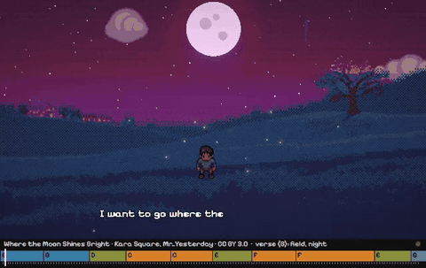
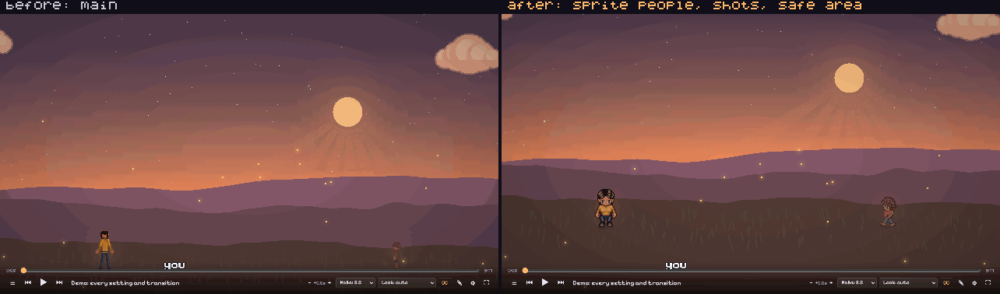
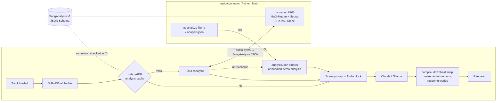
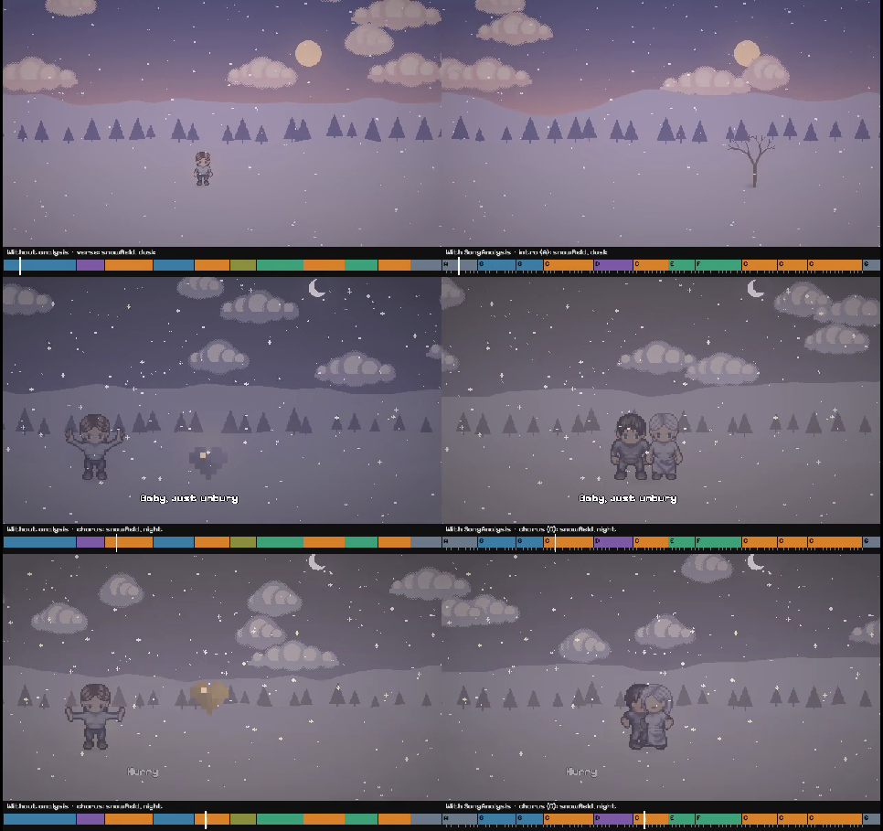
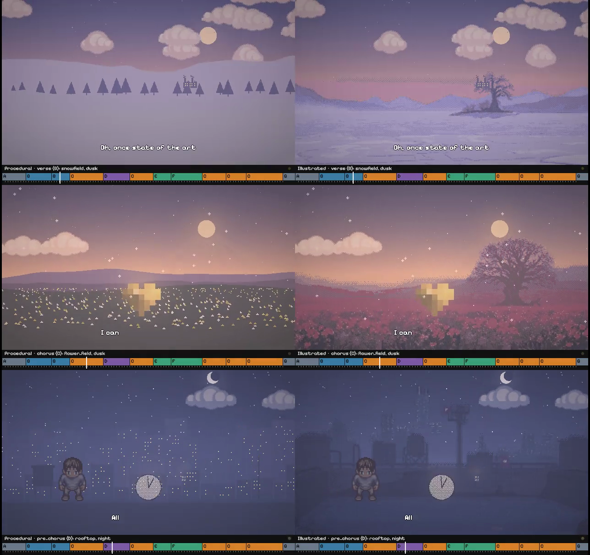

# Visual Music Player

**[Live demo](https://karanr17.github.io/visual-music-player/)** (three CC BY songs in illustrated
mode, and the `?demo` reel; no install, no API key) · **[How it works](https://karanr17.github.io/visual-music-player/about/)**
(architecture, the SongAnalysis contract and the evals on one page) · audio analysis and
recommender: [music-connector](https://github.com/karanr17/music-connector)

[](public/hero.mp4)

*[public/hero.mp4](public/hero.mp4): 79 s with sound, three CC BY 3.0 songs from ccMixter (credits
at the end and under [The hosted demo](#the-hosted-demo)).*

A web music player that pictures what a song *means*. An LLM reads the lyrics once and writes a
scene script; a procedural pixel-art engine draws that script in sync with playback, and the music
drives how alive the scene is. The design and roadmap live in [SPEC.md](SPEC.md).

Static site: Vite + TypeScript, no UI framework, no backend.

## Before and after



*Left: `main` before Phase 1. Right: sprite-sheet people with planted feet, shot framing, and
subjects kept above the captions and player bar. Both sides are `?demo&t=…&freeze` frames at
12 fps.*

## Features

- Local-file playback: drag-drop audio files (and `.lrc` sidecars) or remember a folder.
- Lyrics from a local `.lrc` sidecar or [LRCLIB](https://lrclib.net), with word timing and a
  per-song offset.
- Scene scripts from Claude (subscription or API key) or a local Ollama model, constrained to a
  closed vocabulary so every scene is drawable, and cached per song and model.
- 13 looks (natural, synthwave, lo-fi, noir, storybook, Game Boy, ukiyo-e, …), or a palette taken from
  a reference image.
- People drawn from LPC sprite sheets (walk, idle, sit, reach and dance cycles), recoloured from the
  song's cast, with feet that stay planted while walking.
- A shot per lyric line (wide, medium or close) that sets subject size and where the horizon sits,
  and keeps people above the captions and player bar.
- Optional audio analysis from [music-connector](https://github.com/karanr17/music-connector)
  (tempo, bars, repeating parts, sound descriptors): scene changes land on downbeats, instrumental
  stretches get worlds of their own, and a returning chorus returns to its world. See
  [Audio analysis](#audio-analysis-music-connector).
- Music-driven animation from the analysis's beat grid: footsteps land on beats, the light lifts on
  downbeats, strong beats nudge the camera, standing figures nod along, and particles follow the
  high band. **Beat** in the player bar sets it to off, subtle (default) or strong. See
  [Music-driven animation](#music-driven-animation).
- Optional **illustrated mode**: a backdrop plate per section world, generated once per song on
  your own Mac with FLUX.1-schnell, split into parallax layers and redrawn in the song's palette,
  with the procedural sky, weather, particles and people on top. **▦** in the player bar turns it
  on. See [Illustrated mode](#illustrated-mode).
- Kinetic pixel captions, section transitions, and a JSON scene editor with export/import.
- A built-in `?demo` showcase that needs no audio files and no LLM.

## Run it

Requires Node.js 22 (see `.nvmrc`; Vite 8 needs 20.19+ or 22.12+) and a desktop Chromium browser.
Firefox and Safari can play local files but lack the folder picker.

```sh
git clone https://github.com/karanr17/visual-music-player.git
cd visual-music-player
npm ci
npm run dev
```

Open the URL Vite prints (usually <http://localhost:5173>) and drop an audio file onto the page.

Other scripts:

| Command | What it does |
|---|---|
| `npm run typecheck` | `tsc --noEmit` for the app, then again with Node types for the tests |
| `npm test` | unit tests (vitest): the SongAnalysis schema check, timeline, downbeat snapping, compile, prompt, rhythm, director/script merging |
| `node scripts/eval/run.mjs …` | the scene-script eval (see [docs/eval](docs/eval/README.md)) |
| `npm run build` | typecheck, then a static build into `dist/` |
| `npm run preview` | serve the built `dist/` |
| `scripts/fetch-demo-audio.sh` | download the three CC BY demo songs into `public/audio/` (gitignored), checked by SHA-256 |
| `scripts/check-secrets.sh` | the no-secrets check CI runs (add `--history` to scan every commit) |
| `node scripts/render-comparison.mjs …` | render two scene scripts for one song side by side into an mp4 (see the script's header) |
| `cd scripts/plates && uv run plates generate song.scene.json` | generate illustrated-mode plates for a scene script (see [Illustrated mode](#illustrated-mode)) |
| `node scripts/build-characters.mjs <lpc>` | rebuild the character atlas from a checkout of the LPC generator (see [CREDITS.md](CREDITS.md)) |

## The hosted demo

<https://karanr17.github.io/visual-music-player/> is this app built by
[`.github/workflows/pages.yml`](.github/workflows/pages.yml) on every push to `main`. **Play 3 CC BY
songs** loads three songs from ccMixter with everything precomputed, so nothing runs but the
browser:

| Song (all [CC BY 3.0](https://creativecommons.org/licenses/by/3.0/)) | Credits |
|---|---|
| [Unbury Your Heart](https://ccmixter.org/files/SiobhanD/57378) | remix by Siobhan Dakay; lyrics, music and vocals by Madam Snowflake |
| [Waking Me Softly](https://ccmixter.org/files/Ghost_k/39570) | Ghost_k (Ghost Kollective); lyrics and vocals by Madam Snowflake |
| [Where the Moon Shines Bright](https://ccmixter.org/files/mindmapthat/62227) | remix by Kara Square of Mr_Yesterday (D A Ayer, words and vocals) and Stefan Kartenberg (JeffSpeed68) |

- **Audio** is never committed. The workflow runs `scripts/fetch-demo-audio.sh`, which downloads
  each MP3 from ccMixter, or from the
  [`demo-audio-v1` release](https://github.com/karanr17/visual-music-player/releases/tag/demo-audio-v1)
  when ccMixter refuses the runner, and checks it against the SHA-256 in its analysis. The
  player bar credits the playing song with links to its page and the licence.
- **Analyses** ([`public/analysis/`](public/analysis/)) come from music-connector.
- **Scene scripts** ([`public/scripts/`](public/scripts/)) were written by Claude Sonnet 5.5 (one
  pass, with the analysis) and are picked by the audio's SHA-256 when the browser has no script
  of its own for the song, so the hosted demo needs no LLM. Drop the same MP3 into a local copy
  and you get the same script.
- **Plates** ([`public/plates/`](public/plates/)) come from `scripts/plates` (see
  [Illustrated mode](#illustrated-mode)).
- **Lyrics** ([`public/demo/`](public/demo/)) are the published lyrics timed to each recording:
  by hand for *Unbury Your Heart*, from Whisper and corrected by hand (approximate) for the
  other two.

The [How it works](https://karanr17.github.io/visual-music-player/about/) page
([`public/about/index.html`](public/about/index.html)) is the one-page write-up.

## The `?demo` showcase

Open <http://localhost:5173/?demo> to play a built-in reel that walks through every setting and a
spread of transitions, subjects and weather, with captions. It uses a hand-written scene script, so
it works offline with no provider configured.

| Parameter | Effect |
|---|---|
| `t=<seconds>` | start at that point in the reel |
| `freeze` | hold that frame (useful for screenshots) |
| `style=<name>` | force a look: `natural`, `synthwave`, `lofi`, `noir`, `storybook`, `metal`, `dream`, `ukiyoe`, `impressionist`, `watercolor`, `gameboy`, `nes`, `comic` |

Example: `/?demo&t=70&freeze&style=gameboy`.

## Scene providers

Pick one in **Settings → Scene imagination**. In *Auto* the player tries them in this order:

1. **Claude subscription via Claude Code** (dev server only). `npm run dev` adds a local bridge
   (`/api/claude-code` in `vite.config.ts`) that runs the `claude` CLI, so generation bills your
   Claude plan instead of API credits. Install [Claude Code](https://claude.com/claude-code) and log in;
   the settings dialog shows whether the CLI was found. The bridge accepts same-origin requests only
   and runs the CLI with tools, MCP and settings files disabled. A static build has no bridge.
2. **Claude API key.** Paste a key into the settings dialog. It is stored in this browser's
   `localStorage` and sent only to `api.anthropic.com`.
3. **Ollama** (local). Set the URL and model in the settings dialog (defaults
   `http://localhost:11434`, `llama3.1`). Start Ollama with `OLLAMA_ORIGINS=*` (or this page's
   origin) so it accepts browser requests.

Choose *Off* to get ambient scenes with no LLM at all.

### Two passes: director, then script

**Settings → Plan first** (off by default) makes a scene script take two calls:

1. A **director** model (Claude Sonnet 5.5 by default; set per provider, including an Ollama model)
   reads the lyrics and the audio analysis and writes a plan: a logline, how the song develops, the
   look and cast, the sections with their worlds and transitions, and a shot and a one-line focus
   for every line ("the couple walking apart on the road").
2. The **script** model (the one picked in the player bar, Haiku 5.5 by default) turns the plan into
   the engine's moments: which subjects, where, how they move, particles and accents. If it skips
   part of a long song, it is asked again for the missing lines.

The director decides structure, worlds, shots, look and cast; the script decides what is in each
picture (`mergePasses` in `src/scene/director.ts`). If the director call fails, the song falls back
to a single pass. Scripts may draw at most two tiny props (8-16 px) as sprites; everything else
comes from the vocabulary.

### Does it help? The eval

An LLM judge (Claude Opus 5.5) scored scripts for 10 CC BY songs against a written
[rubric](docs/eval/rubric.md): fit to the lyrics, use of the musical structure, visual variety,
and renderability, 1-10, two samples per script. Method, per-song pairing and limits are in
[docs/eval](docs/eval/README.md).

| Pipeline | Overall (± judge gap) | Fit | Structure | Variety | Render | Unmapped | s / song | API-equiv $ / song |
|---|---|---|---|---|---|---|---|---|
| `main`: one pass, Haiku 5.5 | 6.22 ± 0.35 | **6.5** | 6.0 | 5.5 | 6.8 | 1.3 | 96 | 0.013 |
| two passes v1 (Sonnet director + Haiku script) | 6.16 ± 0.23 | 6.3 | 5.9 | 6.0 | 6.5 | 6.3 | 96 | 0.108 |
| two passes v2 (this branch) | 6.22 ± 0.25 | 6.2 | 6.1 | 5.7 | **7.0** | 2.4 | 115 | 0.110 |
| ablation: one pass, Sonnet 5.5 | **6.26** ± 0.28 | 6.4 | **6.2** | **6.1** | 6.4 | 2.2 | 38 | 0.093 |

The eval found no overall difference: the scores are within 0.1 of each other, less than the
judge's disagreement with itself, and a single pass on Sonnet matches the two-pass pipeline for
less time and money. That is why Plan first is off by default. Within the tie, the two-pass
pipeline gives the most renderable and most consistent scripts but reads the lyrics slightly less
well than one pass. The v1 → v2 iteration fixed real failures (a long song left half empty, a
noisy unmapped log) rather than raising the average. What scripts
asked for and couldn't draw is collected in [docs/vocab-roadmap.md](docs/vocab-roadmap.md); four
of those (record player, factory, volcano, cow) are now in the vocabulary.

### Keys stay out of the repo

The app never reads a key from a file: keys are entered in the UI at runtime. If you keep keys in a
local `.env` for your own tooling, `.env*` is gitignored. CI runs `scripts/check-secrets.sh`, which
fails the build if an API key pattern, an email address, an env file, or a listening-history export
(Google Takeout, Spotify streaming history) is committed.

## Audio analysis (music-connector)

The LLM that writes the scenes can't hear the song. [music-connector](https://github.com/karanr17/music-connector)
can: its `mc serve` analyses a recording (MuQ-MuLan audio embeddings plus librosa) and returns a
**SongAnalysis**, a versioned JSON contract shared by both repos. The player uses it in two places:

- **The prompt** gets an *Audio* block: tempo, the song's parts in time order with recurrence
  letters (`A B B C D D′ C …`, same letter = the same music returning) and their energy, and sound
  descriptors, which the prompt marks as hints that are often wrong. Parts with no singing become
  numbered `(instrumental)` lines, so the model can give them sections and moments.
- **Compiling the script**: section changes move onto the nearest downbeat (within half a bar),
  transitions last a whole number of beats, every instrumental stretch becomes its own section
  (intro, instrumental or outro) even if the model folded it into a neighbour, and a section that
  returns (same recurrence group and same kind of section, after something else) gets the world
  of its first occurrence, laid out identically.



[](docs/analysis-comparison.mp4)

*[docs/analysis-comparison.mp4](docs/analysis-comparison.mp4) (2:16, with sound; stills above at
0:10, 1:10 and 2:05): the same song and model without analysis (left) and with it (right). Without
it, the first verse's world and singer are on screen through the 22 s instrumental intro and
sections change on lyric lines; with it, the intro has its own world, every change lands on a
downbeat, and the chorus at 1:58 comes back to the world of the one at 1:02 with the identical
layout. (Here the model also brought the chorus back to a snowy night without analysis, from the
repeated lyrics; with analysis that is enforced by compile rather than left to the model.) The strip under each picture shows the sections (colour = kind
of section, letter = recurrence group, ticks = downbeats). Song: "Unbury Your Heart" by Siobhan
Dakay feat. Madam Snowflake, CC BY 3.0 (see [docs/demo](docs/demo/README.md)).*

### Music-driven animation

[](docs/beat-muted.mp4)

*Muted, so only the picture keeps time: [docs/beat-muted.mp4](docs/beat-muted.mp4) (16 s, Beat off
on the left, strong on the right). With sound: [docs/beat-with-sound.mp4](docs/beat-with-sound.mp4)
(16 s, subtle on the left, strong on the right). The dot at the bottom right of each strip is a
metronome drawn from the analysis's beats (large on downbeats), to check the picture against.
Same CC BY song and scene script as above; the script is
[docs/demo/unbury-your-heart.scene.json](docs/demo/unbury-your-heart.scene.json).*

With an analysis, `src/audio/rhythm.ts` turns its beats, downbeats and band envelopes into
functions of time, and the renderer reads them at each frame:

| What | Driven by | Subtle / strong |
|---|---|---|
| Walking steps | The walk's pace is the beat position, scaled so a footfall (walk frames 0 and 4) lands on every beat; a walk starts on a beat and turns take whole steps. Half or double time keeps the stride natural for very fast or slow tempos. Dances and idle breathing step with it, and swaying things sway once every two beats. | same |
| Light | Brightness lift on each downbeat and, smaller, each beat, scaled by loudness | up to +5% / +13% on downbeats |
| Camera | A short drop on beats with a strong low-end (kick) hit | 1.2 px / 3 px |
| Heads | Standing and sitting figures dip their heads at the start of each beat | 1 px / 2 px |
| Particles | Density follows the high band (hats, cymbals) within the song's own range | thins to 65% / 30% when the highs drop out |
| Accents | Lightning, flashes and pulses written for a lyric line hit on the nearest beat | same |

Everything is a pure function of the playback time, so seeking, scrubbing and frame-by-frame
capture land on the same picture (a test renders a frame after playing up to it and after
jumping to it, and compares pixels). With **Beat: off**, or with no analysis, the scene moves with
the loudness envelope as before; the `?demo` reel, which has no recording, uses a plain 96 BPM grid.

### Run the two together

```sh
# Terminal 1: music-connector (Apple Silicon or CUDA; the first start downloads the model)
cd music-connector && uv sync && uv run mc serve            # http://127.0.0.1:8765

# Terminal 2: the player
cd visual-music-player && npm run dev                        # http://localhost:5173
```

`mc serve` only answers the player's dev origins (`localhost:5173`, `127.0.0.1:5173`); add others
with `MC_ALLOWED_ORIGINS`. To use another port, run `uv run mc serve --port 8795` and set
**Settings → Audio analysis → music-connector URL** to `http://127.0.0.1:8795`. The first analysis
of a song takes a few seconds and the status line says "Analysing audio…"; after that the result
is cached in the browser (IndexedDB, keyed by the file's SHA-256) and in `mc serve`'s own cache.
The line under the title shows where the analysis came from, e.g. `100 BPM · 13 parts (server)`.

### Without the Mac: sidecar files

The player looks for analysis in this order and uses the first it finds:

1. the IndexedDB cache;
2. the analyses bundled with the static build in [`public/analysis/`](public/analysis/) for the three
   CC BY demo songs, matched by SHA-256 (they are what `mc serve` returns for those exact files);
3. `mc serve` at the configured URL (skipped quickly if it isn't running; on a hosted copy the URL
   starts empty, since `mc serve` only answers the local dev origins);
4. a `.analysis.json` sidecar dropped or opened with the audio: `song.mp3` pairs with
   `song.analysis.json`, and a sidecar with another name is matched by the SHA-256 or file name it
   records (one song plus one sidecar dropped together always pair).

Make a sidecar with `uv run mc analyze song.mp3 -o song.analysis.json`. If none of these has an
analysis, the player works as before: sections follow the lyrics, transitions start at lyric lines.
**Settings → Use audio analysis** turns it all off (scripts with and without analysis are cached
separately, so you can compare).

### The contract

`schema/song-analysis.v1.schema.json` is a vendored copy of music-connector's generated JSON Schema
(SongAnalysis **1.0**, music-connector `826dfc1`). `src/analysis/schema.ts` mirrors it in zod, and
`npm test` fails if the two disagree on any field name, requirement, type, nullability or bound.
Readers accept any `1.x` file and ignore fields they don't know; a `2.x` file is rejected. To take
a new minor version, copy the new schema file over the vendored one and run `npm test`.

## Illustrated mode

[](docs/illustrated-comparison.mp4)

*[docs/illustrated-comparison.mp4](docs/illustrated-comparison.mp4) (1:00, with sound): the same
scene script drawn with the procedural backdrops (left) and with generated plates (right). The
sky, sun and moon, weather, particles, people and objects are the same on both sides; only the
land behind them changes. The flower field in the second still returns at dawn later in the song
from the same plate, re-toned for that time of day. Song: "Unbury Your Heart" by Siobhan Dakay
feat. Madam Snowflake, CC BY 3.0; script and plates are in [docs/demo](docs/demo/README.md).*

The procedural backdrops are cheap, seekable and always in sync, but they are 70% of the frame and
read as programmer art. Illustrated mode keeps the engine and swaps only the land:

1. **The scene script asks for it.** Each section's world now carries `plate`, one sentence from
   the scene model describing the place as a painting ("a wide field of wildflowers running to low
   hills under a glowing amber and rose sky, one old tree on the horizon"), with no people, which
   the engine draws itself. Sections that return to a world repeat its text.
2. **A local CLI makes the plates** (`scripts/plates`, Python with uv). For every distinct place
   in a script it runs [FLUX.1-schnell](https://huggingface.co/black-forest-labs/FLUX.1-schnell)
   (Apache-2.0, 4-bit, on MLX via [mflux](https://github.com/filipstrand/mflux)) at 512×288 with
   a pixel-art game-background prompt, then
   [Depth Anything V2 Small](https://huggingface.co/depth-anything/Depth-Anything-V2-Small-hf)
   (Apache-2.0) for depth. From that it cuts out the sky (a flood fill from the top edge that
   follows smooth colour and stops at far depth and strong edges, plus any moon or sun disc),
   splits the land into far, middle and near layers by depth, inpaints what each nearer layer
   hides, measures where the ground meets the sky, and writes everything, at 384×216, into one
   `song.plates.json` next to the script (about 0.1 MB per song).
3. **The player draws them** when **▦** is on and the song has plates. Each layer is mapped onto the
   section's palette at load: brightness onto the world's tones for its time of day and mood, the
   plate's own main colours pulled toward them, then ordered dithering, so the plates sit in the
   same palette as the sprites and the same plate works at dusk and at dawn. The layers move with
   the camera at three depths, the plate's horizon lands on the engine's horizon so people stand
   on its ground, and the sky, sun, moon, stars, clouds, weather and particles stay procedural on
   top. A drift or slow pan swings back before it reaches the plate's edge.

A section that comes back (same recurrence group from the audio analysis, same setting), or names
the same place in the same words, reuses its plate, so a song of 10-12 sections needed 4-5 images.
Road and river sections keep their procedural backdrop, because their ground scrolls toward the
viewer; rooms are one flat layer. Rendering stays a pure function of time, so seeking and
frame-by-frame capture land on the same picture (a test checks it with plates on).

Generation never runs in the browser or from the hosted app: the player only reads plate files.
With **▦** off, or for a song without plates, or for sections a plate file doesn't match (edited
or regenerated scripts), the player draws exactly what it drew before.

### Make plates for a song

```sh
# 1. In the player, open the scene editor (E) and save the script JSON, e.g. song.scene.json.
# 2. On an Apple Silicon Mac (first run downloads ~9 GB of FLUX weights and ~100 MB for depth):
cd scripts/plates
uv run plates generate path/to/song.scene.json            # writes path/to/song.plates.json
uv run plates generate path/to/song.scene.json --dry-run  # just print the prompts
# 3. Drop song.plates.json onto the player (with or without the audio) and press ▦.
```

Plates are cached in the browser (IndexedDB, by the script's track key) and in the plate file:
re-running after editing one section regenerates only that section's plate. `--raw-dir DIR` keeps
the raw FLUX images, and `--resplit` redoes the depth and layer split from them without
regenerating. `scripts/render-comparison.mjs --right-plates song.plates.json` renders a side by
side like the one above.

The default weights are
[`dhairyashil/FLUX.1-schnell-mflux-4bit`](https://huggingface.co/dhairyashil/FLUX.1-schnell-mflux-4bit),
a 4-bit conversion of the same Apache-2.0 model, because Black Forest Labs' own repository needs a
Hugging Face login and licence click-through. `--model` takes any mflux FLUX.1-schnell checkpoint
or local path.

### Cost and latency

Measured on a MacBook Pro M3 Pro (18 GB), 4 denoising steps, nothing to pay per image:

| | 512×288 (used) | 768×432 |
|---|---|---|
| Seconds per image, memory free | **13.0** (12.6-13.1, n=4) | 25.4 (24.8-26.3, n=4) |
| Peak MLX memory | 12.4 GB | 13.6 GB |

| Step | Time |
|---|---|
| First image after start (reads the 9 GB of weights) | 15 s |
| Depth model load, first run | 14 s |
| Depth + sky cut + layer split + inpainting | 0.5 s per plate |
| The three CC BY demo songs, end to end (12, 10, 10 sections → 5, 5, 4 plates) | 2.4, 3.7, 5.2 min |
| Player: re-toning all of a song's plates on load | 70-85 ms, once |
| Player: frame time, procedural vs illustrated (Node, same frames) | 6.5-11.0 vs 7.4-12.7 ms |

The end-to-end runs were 28, 43 and 75 s per image rather than 13, because they ran next to a
browser, an IDE and other jobs, and FLUX's 12 GB working set pushed an 18 GB Mac into swap (one
image took 186 s). Close other apps, or stop `mc serve` if it has MuQ loaded, before generating.
768×432 looked no better once reduced to plate size, so the CLI uses 512×288.

### Limits

- The plates are FLUX's idea of the place, not the lyrics': the scene model writes the sentence,
  but FLUX.1-schnell follows the setting and light more reliably than specific objects.
- The sky cut is a heuristic. It can leave a thin band of the generated sky above the horizon,
  or a glow round a moon it removed, and in a dark night scene it can take a skyline that is
  nearly the sky's colour.
- The plate's horizon is estimated (the first row that is land almost all the way across), so in
  a valley or on a hilltop people can stand a little above or below the painted ground.
- Apple Silicon only, as written (MLX); about 12 GB of free memory to run well.

## Keyboard

| Key | Action |
|---|---|
| Space | play / pause |
| ← / → | seek 5 s (Shift: previous / next track) |
| `L` | toggle captions |
| `F` | fullscreen |
| `E` | open the scene editor |
| `[` / `]` | lyric offset −/+ 0.1 s |

## License and credits

Code: [MIT](LICENSE). The bundled example analyses and the demo lyrics are derived from CC BY 3.0
songs; see [public/analysis/ATTRIBUTION.md](public/analysis/ATTRIBUTION.md) and [docs/demo](docs/demo/README.md). The character sprites are third-party art under their own licences (OGA-BY
3.0, CC-BY 3.0 or CC0) by the Liberated Pixel Cup artists; see [CREDITS.md](CREDITS.md) for the
authors, licences and per-file credits.
